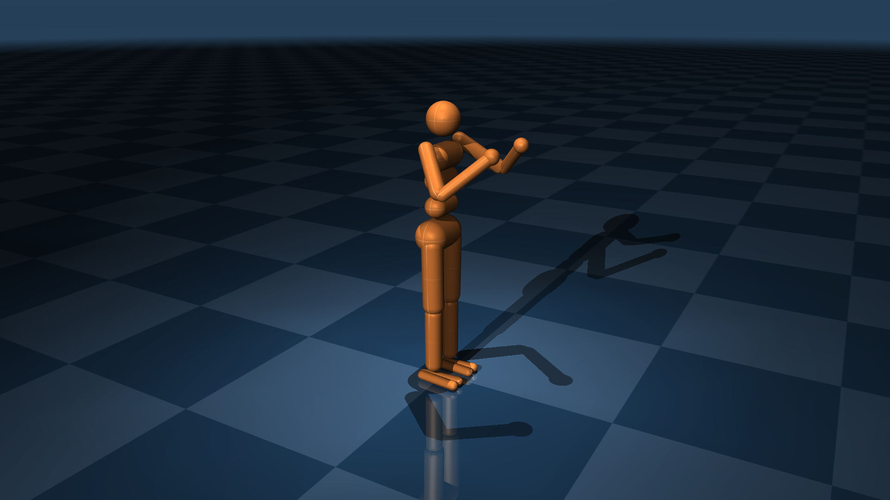

Humanoid
========

自由度：27
执行器：21

这是 [MuJoCo Humanoid](https://github.com/google-deepmind/mujoco/blob/main/model/humanoid/humanoid.xml) 的克隆，
做了以下修改：

* 求解器切换为 CG，迭代 8 次
* 为脚部和地面设置显式接触对（兼容
  [OpenAI Gym Humanoid](https://gymnasium.farama.org/environments/mujoco/humanoid/)
  环境）

这个简化的人形模型由 [1] 提出，面向双足运动行为。虽然存在多种变体，
本版本基于 DeepMind Control Suite [2] 中的模型，其执行器增益较为真实。

[1] [Synthesis and Stabilization of Complex Behaviors through Online Trajectory Optimization]
     (https://doi.org/10.1109/IROS.2012.6386025).

[2] [DeepMind Control Suite](https://arxiv.org/abs/1801.00690).

