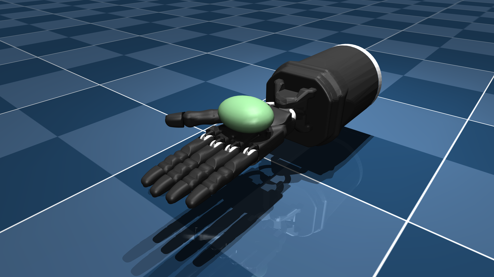

# Shadow Hand E3M5 描述 (MJCF)

需要 MuJoCo 3.0.0 或更高版本。

## 概述

本包包含 Shadow Hand 机器人 "E3M5" 版本的资源，包括右手和左手两个版本。
原始 URDF 和资源由 [Shadow Robot Company](https://www.shadowrobot.com/) 直接提供，采用 [Apache 2.0 许可证](LICENSE)。

[原始 Menagerie Shadow Hand](https://github.com/google-deepmind/mujoco_menagerie/tree/main/shadow_hand) 已针对 MJX 仿真做了以下修改：

* 求解器切换为 CG，迭代 8 次
* Condim 切换为 3（MJX 尚不支持 condim != 3）
* 物体从椭球体改为球体（MJX 尚不支持椭球体）
* 为手指和物体添加显式接触对
* 移除手臂基座中一些未使用的 geom

  

## 许可证

这些模型基于 [Apache-2.0 许可证](LICENSE) 发布。