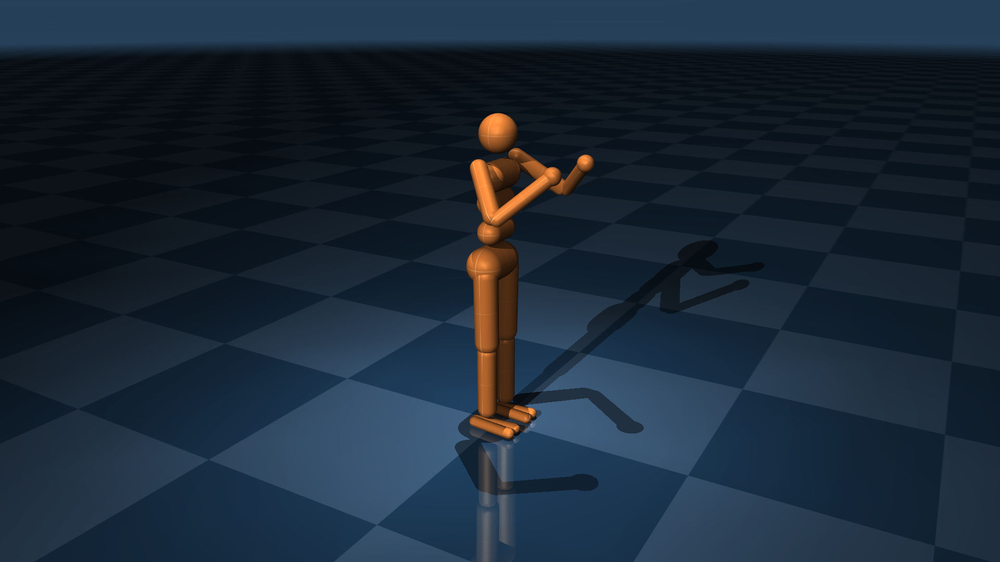

# Humanoid

这个简化的人形模型由 [1] 提出，用于双足运动行为。虽然存在多种变体，但此版本基于 DeepMind Control Suite [2] 中的模型，其执行器增益相当接近真实。

* 自由度：27
* 执行器：21

  

## 变更日志

* 08-10-2024：将跟踪光源从躯干移至世界。
* 20-02-2024：按关节顺序排列执行器。
* 02-01-2024：添加更多关键帧。
* 27-11-2023：将人形几何体移至组 1。
* 05-04-2023：修复纹理尺寸中的拼写错误。
* 20-09-2022：为 left_upper_arm 几何体使用默认类。
* 17-09-2022：将人形的离屏渲染缓冲区分辨率提升至 2560x1440。
* 12-09-2022：
  * 增大最大髋关节屈曲角度。
  * 对称化肩关节和踝关节。
  * 添加腘绳肌腱，在大屈曲角度下耦合髋关节和膝关节。
  * 将重复值移入默认值。
  * 添加两个关键帧。
  * 改进光照。
  * 更改命名约定。

## 参考文献

[1] [Synthesis and Stabilization of Complex Behaviors through Online Trajectory Optimization](https://doi.org/10.1109/IROS.2012.6386025)。

[2] [DeepMind Control Suite](https://arxiv.org/abs/1801.00690)。