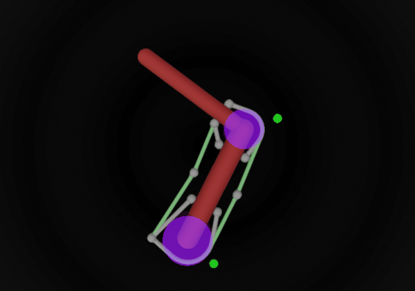

# 双连杆六肌肉手臂

一个平面手臂，带肩关节和肘关节铰链，由六块[肌肉](https://mujoco.readthedocs.io/en/latest/modeling.html#cmuscle)驱动，肌肉通过[空间肌腱](https://mujoco.readthedocs.io/en/latest/XMLreference.html#tendon-spatial)作用，肌腱绕过关节处的圆柱体。这是运动控制研究中经典的双连杆六肌肉手臂（[Katayama & Kawato 1993](https://doi.org/10.1007/BF01185407)；[Li & Todorov 2004](https://doi.org/10.5220/0001143902220229)）。不要将其与同名的 OpenSim 解剖学模型混淆。

  

点击图片可在浏览器查看器 [live.mujoco.org](https://live.mujoco.org) 中打开该模型。

| 肌肉 | 跨越 | 作用 |
| --- | --- | --- |
| `SF` | 肩 | 屈肌 |
| `SE` | 肩 | 伸肌 |
| `EF` | 肘 | 屈肌 |
| `EE` | 肘 | 伸肌 |
| `BF` | 肩和肘 | 双关节屈肌 |
| `BE` | 肩和肘 | 双关节伸肌 |

屈肌无需辅助即可绕过弯曲内侧的关节圆柱体。伸肌绕过外侧，而最短路径在关节弯曲时会脱离外侧，因此每个伸肌几何体的包裹都设有一个[侧位点](https://mujoco.readthedocs.io/en/latest/XMLreference.html#spatial-geom-sidesite)（肩部为 `x0`，肘部为 `x1`，与圆柱体一同以绿色显示在第 1 组中）。肌腱绕过圆柱体的方式与经过其侧位点的路径相同，当附着位点越过侧位点对面的射线时即脱离。因此侧位点置于手臂下方 45°，使该射线在 0–120° 关节范围内避开插入位点。

## 变更日志

* 2026-10-28：为适应新的侧位点语义，将侧位点 `x0` 和 `x1` 从手臂下方 90° 移至 45°。在整个运动范围内肌腱长度不变。
* 2021：初始发布。