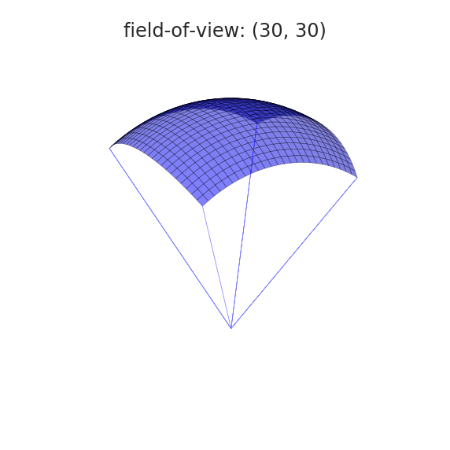
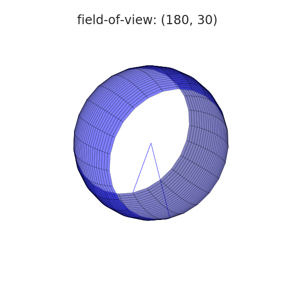
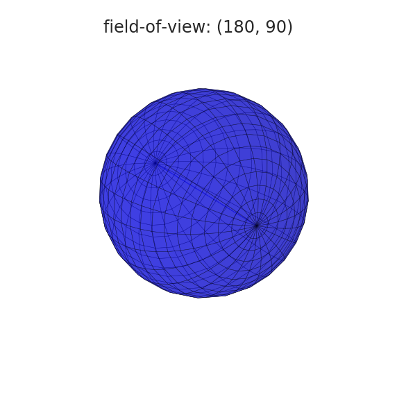
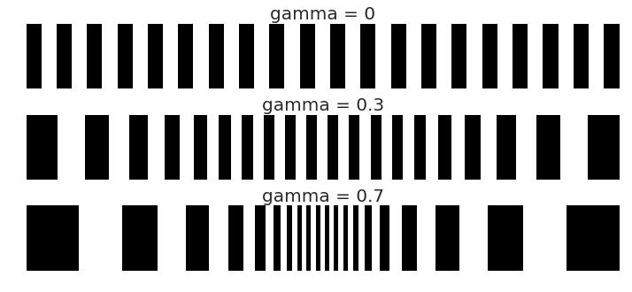

# 传感器插件

以[引擎插件](https://mujoco.readthedocs.io/en/latest/programming/extension.html#engine-plugins)形式实现的自定义传感器。

- [Touch Grid](#touch-grid)
  - [示例模型](#示例模型)
  - [球坐标系下的视场示意图](#球坐标系下的视场示意图)
  - [中央凹变形示意图](#中央凹变形示意图)
  - [分辨率、视场与中央凹变形综合示意图](#分辨率视场与中央凹变形综合示意图)

- [Touch Stress](#touch-stress)

## [Touch Grid](touch_grid.h)

该传感器将接触力聚合为“触元”（taxel）：一个类似像素的矩形阵列。

`touch_grid` 传感器关联到一个 site，感知该 site 父刚体与所有其他刚体之间的接触力和力矩。site 的坐标系决定传感器朝向，约定与相机和光源相同：传感器指向坐标系的 **负 z** 方向，因此 x 轴和 y 轴分别对应水平和垂直方向。

传感器输出为 1 到 6 张“触觉图像”的堆叠，对应传感器坐标系下的力和力矩。力和力矩按 [z, x, y] 顺序排列，与接触坐标系的顺序一致：[法向, 切向, 切向] 和 [扭转, 滚动, 滚动]。每个“触元”对应球坐标系中的一个角度区间，聚合该区间内发生的所有力，这些力发生在传感器 site 所在刚体与任意其他刚体之间。

传感器由 6 个参数定义：

1. 通道数，按上述顺序。_正整数，范围 [1, 6]_
2. 水平分辨率。_正整数_
3. 垂直分辨率。_正整数_
4. 水平视场角。_正浮点数，范围 (0, 180] 度_
5. 垂直视场角。_正浮点数，范围 (0, 90] 度_
6. 中央凹变形。_正浮点数，范围 [0, 1]_

视场角和中央凹变形参数的可视化说明见下方示意图。这些参数通过插件配置属性传入：

```xml
<mujoco>
  <extension>
    <plugin plugin="mujoco.sensor.touch_grid"/>
  </extension>
  ...
  <sensor>
    <plugin name="touch" plugin="mujoco.sensor.touch_grid" objtype="site" objname="touch">
      <config key="nchannel" value="3"/>
      <config key="size" value="7 7"/>
      <config key="fov" value="45 45"/>
      <config key="gamma" value="0"/>
    </plugin>
  </sensor>
</mujoco>
```

注意以下事项：

- 传感器输出的维度为 `nchannel * size_x * size_y`。
- `objtype="site" objname="touch"` 指定传感器关联到 site，以及具体 site 的名称。
- 视场角始终以度为单位，不受 `<compiler>` 的 "angle" 指令影响。

### 示例模型

<a href="https://youtu.be/0LOJ3WMnqeA" target="_blank">
 
</a>

参见 [touch_grid.xml](../../model/plugin/sensor/touch_grid.xml) 体验上述模型。

### 球坐标系下的视场示意图





### 中央凹变形示意图



### 分辨率、视场与中央凹变形综合示意图

[](https://www.youtube.com/watch?v=YScjmR8LwQI)

## Touch Stress

`touch_stress` 传感器插件在 MuJoCo 3.3.5 中已移除，其功能已作为原生 [`tactile`](https://mujoco.readthedocs.io/en/latest/XMLreference.html#sensor-tactile) 传感器移入引擎。示例模型参见 [tactile.xml](../../model/tactile/tactile.xml)。